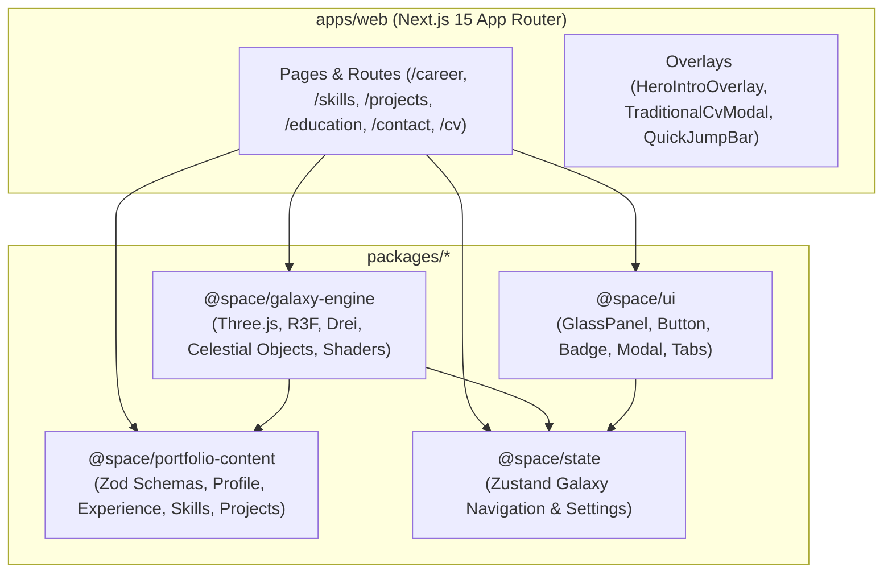

# Architecture Documentation

## System Overview

The 3D Space Exploration Developer Portfolio & Interactive CV for **Nguyen Bao Duy** transforms a traditional software engineering CV into an immersive, celestial exploration experience while maintaining enterprise-grade usability, accessibility, and search engine discoverability.

The application is architected as a modular monorepo powered by **Turborepo** and **pnpm workspaces**. It enforces strict separation of concerns across personal content schemas, shared state, UI primitives, and the 3D WebGL engine.



---

## Monorepo Structure

```text
space-portfolio/
├── apps/
│   └── web/
│       ├── public/
│       ├── src/
│       │   ├── app/
│       │   │   ├── (portfolio)/
│       │   │   │   ├── page.tsx
│       │   │   │   ├── career/page.tsx
│       │   │   │   ├── skills/page.tsx
│       │   │   │   ├── projects/
│       │   │   │   │   ├── page.tsx
│       │   │   │   │   └── [slug]/page.tsx
│       │   │   │   ├── education/page.tsx
│       │   │   │   ├── contact/page.tsx
│       │   │   │   └── cv/page.tsx
│       │   │   ├── layout.tsx
│       │   │   ├── globals.css
│       │   │   ├── loading.tsx
│       │   │   ├── error.tsx
│       │   │   ├── not-found.tsx
│       │   │   ├── sitemap.ts
│       │   │   └── robots.ts
│       │   └── components/
│       │       ├── navigation/
│       │       ├── overlays/
│       │       └── common/
│       ├── next.config.ts
│       ├── tailwind.config.ts
│       └── package.json
├── packages/
│   ├── portfolio-content/    # Typed content definitions, Zod schemas, navigation coordinates
│   ├── state/                # Zustand stores for camera, destination, viewMode, quality
│   ├── ui/                   # Shared glassmorphic and accessible UI primitives
│   ├── galaxy-engine/        # React Three Fiber 3D scene, procedural stars, planets, stations
│   └── config-typescript/    # Shared TypeScript configurations
├── docs/                     # Full technical documentation
├── turbo.json
├── pnpm-workspace.yaml
└── package.json
```

---

## Package Boundaries & Responsibilities

### 1. `apps/web`
- **Responsibility:** Next.js 15 App Router application handling routing, server-side rendering for SEO and crawlability, client boundary composition, responsive layouts, metadata generation, and sitemap/robots.
- **Key Design Decision:** The 3D canvas is dynamically imported with `ssr: false` inside a client component, allowing immediate HTML rendering of metadata, navigation shell, and crawler-friendly structural content before WebGL shaders compile.

### 2. `packages/portfolio-content`
- **Responsibility:** Single source of truth for all career data, verified against Nguyen Bao Duy's CV.
- **Independence:** Zero runtime dependencies on React or Three.js. It only uses `zod` for type inference and runtime schema validation.
- **Extensibility:** Adding new employers, technologies, or projects is done by simply adding a typed entry without touching rendering logic.

### 3. `packages/state`
- **Responsibility:** Shared Zustand store (`useGalaxyStore`).
- **State Managed:**
  - `currentDestination`: ('home' | 'career' | 'skills' | 'projects' | 'education' | 'contact')
  - `viewMode`: ('3d' | 'conventional' | 'cv')
  - `graphicsQuality`: ('high' | 'medium' | 'low')
  - `reducedMotion`: boolean (auto-detected from system media queries)
  - `webglSupported`: boolean
  - `isTraveling`: boolean camera transition state
  - `activeOverlay`: ('none' | 'cv-modal' | 'project-modal' | etc.)

### 4. `packages/ui`
- **Responsibility:** Clean, reusable design system components with backdrop-blur glassmorphism, subtle glowing borders, and accessible keyboard interactions (GlassPanel, Button, Badge, Modal, Tabs, Tooltip).

### 5. `packages/galaxy-engine`
- **Responsibility:** Declarative 3D scene graph using `@react-three/fiber` and `@react-three/drei`.
- **Components:** Multi-tier particle starfield, volumetric nebula clouds, procedural celestial objects, orbital rings, HTML 3D annotations (`CelestialLabel`), and an automated lerp camera transition controller.
- **Fallback:** Includes `WebGLFallback`, a 2D sector map for low-powered or WebGL-restricted devices.

